# SEIR-Vector Malaria Model with an Urban Drainage (Clogging) Index
### Model report for supervisor meeting

**Status of everything in this report:**
- **Synthetic climate.** The temperature and rainfall series are invented for testing. They are not real weather data.
- **Mostly placeholder parameters.** Most parameter values have no confirmed literature source and are labelled PLACEHOLDER.
- **Uncalibrated K_0.** K_0, the scale of mosquito breeding habitat, has not been calibrated against any real data.

The results show how the model *behaves*. They are not findings about any real city.

Every number below comes from a fresh run of `python main.py` (runtime 127 s, all 42 tests passing) or
from the parameter file `src/malaria_model/params.py`. Section 13 lists how the numbers were checked.

---

## 0. One-page summary

**What was built.** I implemented the 8-compartment mosquito–human malaria model from the approved spec
(`docs/SPEC.md`) in Python (`scipy.integrate.odeint`, time in days). It runs with one command,
`python main.py`. That command simulates three example city wards with different drainage quality,
sweeps an 81-cell grid of drainage settings, finds threshold values of the Clogging Index Ω, and runs
sensitivity analyses. There are two model variants:
- **"spec":** the approved equations exactly, plus four numerical safety guards. The guards never
  activate with the current climate inputs.
- **"extended":** the spec plus two realism changes. Breeding water persists after rain, and a small
  number of infections are imported from outside the ward.

**What works.**
- Both variants run end to end, and all 42 automated tests pass.
- The spec variant reproduces earlier results exactly (regression test).
- Every departure from the spec is logged (deviations #1–#9).

**Key results (synthetic climate, placeholder parameters):**
1. **Worse drainage gives more malaria in every run.** Higher Ω means more mosquitoes and more
   infections. This ranking held in every run: both variants, all 9 combinations of the two most
   uncertain transmission parameters, and all 4 importation rates tested.
2. **Only the worst ward sustains transmission on its own.** With importation switched off, infection
   grows year to year only above **Ω ≈ 8.7** (8.673 spec, 8.761 extended). Of the three example wards,
   only the poor ward (Ω = 8.911) is above this. The other two are dying out.
3. **The two "safe" thresholds differ enormously.** The Ω at which R0 (the reproduction number) never
   exceeds 1 during the year is **0.044 (spec) / 0.083 (extended)**. The Ω at which infection stops
   persisting is about **8.7**, roughly **100–200 times larger**. Which threshold counts as "safe"
   changes the policy message completely.
4. **In the extended variant, imported cases dominate the better wards.** With the placeholder rate
   of 1 imported infection per 1,000 people per year, about 78% (best ward) and 65% (medium ward) of
   all infections are imported.

**Three main caveats.**
1. The climate is synthetic and most parameters are placeholders. In particular, the
   vector-to-human transmission probability β_hv is at the low end of literature values.
2. K_0 is uncalibrated, so absolute case numbers (all very small) are not meaningful. Only the
   comparisons between wards are informative.
3. The poor ward did not reach a steady state within the 20-year spin-up in either variant, and it
   sits close to the persistence threshold.

**Decisions needed from you (details in Section 11):**
- a calibration target and its source
- whether the extended changes (rainfall memory, importation) are acceptable
- which threshold to treat as "safe"
- the sources for β_hv and γ_h (recovery rate)
- whether to model treatment
- which heatmap metric to use as primary

---

## 1. Purpose and research question

**Question:** do the build quality of urban drainage and how well it is maintained change malaria
outcomes in a city ward? If so, how much maintenance is "enough" for a given drainage network?

Blocked or sparse drains leave standing water after rain, and standing water is mosquito breeding
habitat. The spec captures this with a single **Clogging Index Ω**, built from two ward properties:
- **D_d, drainage density:** how much drainage infrastructure exists, on a scale of 0 to 1.
- **M_i, maintenance efficiency:** how clear the drains are kept (0 = fully blocked, 1 = perfectly clear).

Ω then feeds into the mosquito part of a standard malaria transmission model.

---

## 2. The model in plain language

The model tracks how many mosquitoes and how many people are in each "state" (compartment) every
day. There are **8 compartments**.

**Mosquitoes:**
- **A_v, aquatic stage:** eggs and larvae living in water. Their number is limited by how much water
  habitat exists, the *carrying capacity* K_v.
- **S_v, susceptible adults:** not infected.
- **E_v, exposed adults:** carrying the parasite, but it isn't yet in their salivary glands, so they
  can't infect anyone yet.
- **I_v, infectious adults:** can infect humans when they bite.

**Humans:**
- **S_h, susceptible:** can be infected.
- **E_h, exposed:** infected, but the parasite is still developing (liver stage), so not yet infectious.
- **I_h, infectious:** can infect mosquitoes that bite them.
- **R_h, recovered:** immune for a while, then return to S_h.

N_h = S_h + E_h + I_h + R_h is the total human population. N_v = S_v + E_v + I_v is the total number
of adult mosquitoes.

**How individuals move between compartments:**
- **Mosquito life cycle.** Adults lay eggs into A_v, and larvae mature into adult S_v.
- **Mosquito infection.** A susceptible mosquito that bites an infectious human may become infected
  (S_v → E_v). After the parasite's incubation period it becomes infectious (E_v → I_v). Mosquitoes
  die at a temperature-dependent rate.
- **Human infection.** A susceptible human bitten by an infectious mosquito may become infected
  (S_h → E_h). They then become infectious (E_h → I_h), recover (I_h → R_h), and later lose immunity
  (R_h → S_h). People are born or immigrate into S_h, die naturally from every compartment, and die
  from malaria from I_h.

**How climate enters:**
- **Temperature T (°C)** sets three things:
  - how often mosquitoes bite, a(T)
  - how fast the parasite develops inside the mosquito, γ_m(T)
  - how fast adult mosquitoes die, μ_v(T)
- **Rainfall R (mm/day)** sets two things:
  - the carrying capacity K_v: more rain means more breeding water
  - "flushing": very heavy rain washes larvae away and adds to larval mortality μ_A

**Flow diagram** (solid arrows = movement between compartments; dotted = influence):

```
                      MOSQUITOES                                     HUMANS
  rain R(t), Ω ──► K_v (habitat)                         Λ_h (births/immigration)
                    :                                          │
  eggs  φ_v·N_v ──► [A_v] ──θ_A──► [S_v] ──bite infected──► [E_v] ──γ_m(T)──► [I_v]
                      │              │      human (β_vh)      │                │
                (θ_A+μ_A(R))·A_v   μ_v(T)                  μ_v(T)          μ_v(T)
                 (maturation /                                                  :
                  larval death)                                infectious bites (β_hv)
                                                                                 ▼
                         ┌──────────────── ρ (loss of immunity) ─────────────┐
                         ▼                                                    │
                        [S_h] ──bite by I_v──► [E_h] ──α_h──► [I_h] ──γ_h──► [R_h]
                          │                      │              │   ╲           │
                         μ_h                    μ_h            μ_h   δ_h       μ_h
                                                              (malaria death)
   I_h ···· infects biting mosquitoes (S_v → E_v)
```

---

## 3. The Clogging Index Ω

**Formula (SPEC §1):**

```
Ω = D_m = (1 - M_i) / (D_d + epsilon)
```

with D_d ∈ [0, 1], M_i ∈ [0, 1] and epsilon = 0.001. Epsilon is a smoothing constant that prevents
division by zero when D_d = 0.

**Intuition.** The numerator (1 − M_i) is "how blocked the drains are". The denominator D_d is "how
much drainage there is". Ω is large when drains are blocked **and** sparse, and it shrinks when
either improves.

**Two reinforcing effects of Ω.** You confirmed both are intended.
1. **More habitat.** Ω raises the carrying capacity: `K_v(R, Ω) = K_0 * (1 + eta * Ω) * R(t)`.
2. **Less flushing.** Ω divides the flushing term in larval mortality, so clogged areas lose fewer
   larvae to heavy rain: `μ_A(R(t)) = μ_base + μ_flush * max(0, (R(t) - R_flush) / (Ω + epsilon))`.

Both push in the same direction: higher Ω means more larvae surviving.

**Worked example: the three illustrative wards.** These profiles were chosen by us; they are not real wards.

| Ward profile | D_d | M_i | Ω = (1 − M_i)/(D_d + 0.001) | Habitat multiplier 1 + ηΩ (η = 0.5) | Flushing divisor Ω + ε |
|---|---|---|---|---|---|
| High infrastructure / high maintenance | 0.8 | 0.9 | 0.1/0.801 = **0.1248** | 1.062 | 0.1258 |
| Medium infrastructure / low maintenance | 0.5 | 0.3 | 0.7/0.501 = **1.3972** | 1.699 | 1.3982 |
| Poor infrastructure / neglected | 0.1 | 0.1 | 0.9/0.101 = **8.9109** | 5.455 | 8.9119 |

So the poor ward has about 5 times the habitat of the best ward on the same rain. On a heavy-rain
day its flushing term is about 70 times weaker (8.9119 / 0.1258).

The 9 × 9 grid of D_d and M_i values from 0.1 to 0.9 covers **Ω from 0.1110 to 8.9109**.

---

## 4. Equations and parameters

### 4.1 Equations (copied from SPEC.md; not paraphrased)

**Section 1: Clogging Index**
```
Ω = D_m = (1 - M_i) / (D_d + epsilon)
```

**Section 2: Aquatic carrying capacity and larval mortality**
```
K_v(R, Ω) = K_0 * (1 + eta * Ω) * R(t)
```
```
μ_A(R(t)) = μ_base + μ_flush * max(0, (R(t) - R_flush) / (Ω + epsilon))
```

**Section 3: Thermal response functions** (T = temperature, °C)
```
a(T) = c_a * T * (T - T_0) * sqrt(T_m - T)
```
```
γ_m(T) = (T - T_min) / DD
```
```
μ_v(T) = 1 / (q_0 + q_1*T + q_2*T^2)
```

**Section 5: ODE system**
```
dA_v/dt = φ_v * (1 - A_v / K_v(R, Ω)) * (S_v + E_v + I_v) - (θ_A + μ_A(R)) * A_v

dS_v/dt = θ_A * A_v - a(T) * β_vh * (I_h / N_h) * S_v - μ_v(T) * S_v

dE_v/dt = a(T) * β_vh * (I_h / N_h) * S_v - (γ_m(T) + μ_v(T)) * E_v

dI_v/dt = γ_m(T) * E_v - μ_v(T) * I_v
```
```
dS_h/dt = Λ_h - a(T) * β_hv * (I_v / N_h) * S_h - μ_h * S_h + ρ * R_h

dE_h/dt = a(T) * β_hv * (I_v / N_h) * S_h - (α_h + μ_h) * E_h

dI_h/dt = α_h * E_h - (γ_h + μ_h + δ_h) * I_h

dR_h/dt = γ_h * I_h - (ρ + μ_h) * R_h
```

The "spec" variant implements exactly these equations. The only additions are the guards
#1–#4 (Section 6), which change nothing at the temperatures and rainfall used here.

### 4.2 Parameter table (all rates per day)

"Lit." means the value comes from a named source that I believe is correct but **still need to verify
against the paper**. PLACEHOLDER means no literature value has been sourced yet.

| Symbol | Meaning | Value | Units | Source / status |
|---|---|---|---|---|
| ε (epsilon) | smoothing constant | 0.001 | – | SPEC §1 |
| K_0 | carrying-capacity scale | 500 | mosquitoes per (mm/day) | **PLACEHOLDER**, uncalibrated |
| η (eta) | sensitivity of K_v to Ω | 0.5 | – | **PLACEHOLDER** |
| μ_base | baseline larval mortality | 0.1 | 1/day | **PLACEHOLDER** |
| μ_flush | flushing coefficient | 0.005 | (1/day)/(mm/day) | **PLACEHOLDER** |
| R_flush | rain threshold for flushing | 15 | mm/day | **PLACEHOLDER** |
| c_a, T_0, T_m | Brière biting-rate constants | 2.03×10⁻⁴, 11.7, 42.3 | –, °C, °C | Lit.: Mordecai et al. 2013 (verify) |
| T_min, DD | degree-day parasite development | 16, 111 | °C, °C·day | Lit.: classic Detinova/Macdonald P. falciparum model (verify) |
| q_0, q_1, q_2 | mosquito mortality quadratic | −4.4, 1.31, −0.03 | day, day/°C, day/°C² | Lit.: Martens (1997) survival formula (verify) |
| φ_v | egg-laying (oviposition) rate | 10 | female eggs/adult/day | **PLACEHOLDER** |
| θ_A | aquatic → adult maturation | 0.1 | 1/day | **PLACEHOLDER** |
| β_vh | human → mosquito transmission probability per bite | 0.48 | – | approx. Chitnis, Hyman & Cushing 2008 (verify) |
| β_hv | mosquito → human transmission probability per bite | 0.022 | – | approx. Chitnis et al. 2008 (verify); **low end of quoted range, open question** |
| Λ_h | human births/immigration | 0.4566 | humans/day | derived: μ_h × 10,000, so the disease-free population is stable |
| μ_h | human natural death rate | 4.566×10⁻⁵ (= 1/(60·365)) | 1/day | **PLACEHOLDER** (60-year life expectancy) |
| α_h | human incubation rate E_h → I_h | 0.0833 (= 1/12) | 1/day | **PLACEHOLDER** |
| γ_h | human recovery rate | 0.0035 | 1/day | approx. Chitnis et al. 2008; **NEEDS VERIFICATION** (changed from an unsourced 0.01, see PROGRESS.md) |
| δ_h | malaria death rate | 1×10⁻⁴ | 1/day | **PLACEHOLDER** |
| ρ | loss of immunity R_h → S_h | 0.00274 (= 1/365) | 1/day | **PLACEHOLDER** |

**Numerical guards and settings:**
- K_V_MIN = 1 mosquito; Q_DEN_MIN = 1 day (guards #1 and #4).
- odeint maximum step 1 day; relative and absolute tolerance 10⁻⁶.

**Extended variant only** (all PLACEHOLDER):
- τ (TAU_RAIN) = 10 days: how long breeding water persists.
- R_EFF_MIN = 0.01 mm/day: numerical floor.
- Imported infections = 1 per 1,000 people per year.
- Ω-lengthens-τ switch: OFF (slope 0.1 if switched on).

**Initial conditions** (a decision, not in the spec):
- Humans: N_h = 10,000 with I_h = 10 seed infections; all other human infected classes 0.
- Larvae start at the day-0 carrying capacity, adults at the level that larval maturation supports.
- No initial infected mosquitoes.

---

## 5. Synthetic climate

**Synthetic data, not real weather.** It is designed to look like a monsoon city, with day 0 = 1 January.

- **Temperature:**
  - a smooth seasonal cosine, T(t) = 28 + 4·cos(2π(t − 135)/365)
  - range 24.00–32.00 °C, mean 28.00 °C
  - hottest on day 135 (mid-May, pre-monsoon), coolest on day 317
  - no day-to-day noise
- **Rainfall:**
  - a low dry-season background (0.2 mm/day) plus a bell-shaped monsoon centred on day 212 (late
    July, width 30 days, mean peak 15 mm/day)
  - multiplied by random day-to-day noise (log-normal, fixed seed 42, so every run is identical)
  - annual total **1,357 mm**, of which **1,246 mm (92%)** falls June–September (days 151–272)
  - daily values range from 0.064 to 48.07 mm/day, the maximum on day 226
  - **27 days** exceed the flushing threshold of 15 mm/day
- **Rainfall with memory** (extended variant only, τ = 10 days):
  - same mean as R (3.72 mm/day)
  - but smoother: range 0.174–19.57 mm/day

**Why synthetic:** so the model could be built and tested before real data are chosen. The shapes
are plausible, but nothing here should be read as describing a real place.

The bottom two panels of the ward figures (Section 8) show T(t) and R(t).

---

## 6. Two variants and all deviations from the spec

**"spec":** the SPEC equations exactly, with guards #1–#4, which are inactive for this climate.

**"extended":** two changes on top of spec:
1. **Rainfall memory.** K_v is driven by R_eff, an exponentially weighted average of past rainfall
   with retention time τ, so breeding water doesn't vanish the day rain stops. Flushing still uses
   same-day rain.
2. **Importation.** A small constant flow of infections from outside (travel) moves people
   S_h → E_h. This keeps the population total unchanged.

Both variants use "spin-up": the model runs repeated years of the same climate until it settles,
and only the final year is reported (#5, #9).

All deviations below are logged in `docs/DEVIATIONS.md`, marked in the code with `# DEVIATION:`, and
were approved by me (the student) during development. **None has yet been reviewed by you.**

| # | What changed | Why | Variant | Status in current results |
|---|---|---|---|---|
| 1 | K_v floored at 1 mosquito | avoid A_v/K_v ÷ 0 on rain-free days | both | inactive (rain > 0 every day) |
| 2 | a(T) = 0 outside T_0 < T < T_m | formula gives NaN/negative outside | both | inactive (24–32 °C) |
| 3 | γ_m(T) floored at 0 below T_min | negative development is not physical | both | inactive |
| 4 | μ_v denominator floored at 1 day (μ_v ≤ 1/day) | denominator ≤ 0 below ~3.7 °C and above ~40 °C | both | inactive |
| 5 | 3-year fixed spin-up, report year 3 | remove dependence on the arbitrary day-0 seed | both | used in regression test and threshold calculations |
| 6 | K_v uses R_eff (τ = 10 d, floor 0.01 mm/day) instead of R(t) | breeding water persists after rain | extended | **active** |
| 7 | τ grows with Ω (clogged drains hold water longer) | plausible mechanism | extended | switch **OFF**, not used |
| 8 | imported infections S_h → E_h at 1 per 1,000/yr | travel-related cases; infection must otherwise survive the dry season alone | extended | **active** |
| 9 | spin-up until local infections change < 1%/yr (cap 20 yr) | 3 years did not reach a steady pattern | both | **active** in main results |

---

## 7. Implementation overview

**Module map** (`src/malaria_model/`):

| File | Role |
|---|---|
| `params.py` | every number, each with its source or PLACEHOLDER label |
| `config.py` | chooses the variant (spec / extended) and spin-up mode |
| `climate.py` | thermal functions a(T), γ_m(T), μ_v(T); synthetic T(t), R(t); R_eff |
| `drainage.py` | Ω, K_v, μ_A |
| `ode.py` | the 8 equations; simulation; spin-up |
| `metrics.py` | peak I_h, attack rate, local vs imported infections, EIR (infectious bites per person per year) |
| `r0.py` | R0(t) from the next-generation matrix |
| `scenarios.py` | runs the three wards and builds the summary table |
| `optimize.py` | the 81-cell D_d × M_i sweep (parallel) |
| `omega_analysis.py` | R0 vs Ω, Ω*, persistence threshold, minimum M_i |
| `sensitivity.py` | γ_h × β_hv and importation sensitivity runs |
| `calibrate.py` | K_0 calibration (built and tested; **not run**, no target yet) |
| `plotting.py` | all figures |
| `parallel.py` | runs grid cells in parallel processes |

**How to run** (from the project folder):
- `.venv/bin/python main.py` runs everything (127 s on this machine) and writes the figures.
- `.venv/bin/python -m pytest` runs the 42 tests.

**What the tests check:**
- hand-calculated values of every formula
- no negative compartments and no NaN/infinite values
- the human population balance holds, including with importation
- the spec variant reproduces earlier results and is unaffected by extended-only parameters
- rainfall-memory properties
- spin-up convergence behaviour
- a calibration round-trip
- the threshold calculations

**Reproducibility:**
- fixed random seed (42)
- package versions pinned in `requirements.txt`
- Python 3.14
- deterministic ODE solver

---

## 8. Results

**How to read these numbers:**
- **Attack rate:** new infections per 1,000 people during the reported year.
- **EIR:** infectious bites per person per year.
- **Peak I_h:** the most people infectious at the same time, out of 10,000.
- **Growth (local):** locally acquired infections this year divided by last year. Below 1 means
  dying out; above 1 means growing.
- **R0(t):** how many new infections one case would cause at day t's temperature and mosquito density.

### 8.1 Per-ward summary (final reported year)

**Spec variant** (uncalibrated K_0 = 500; placeholder parameters):

| Ward (Ω) | Mosquitoes per human (mean / peak) | EIR /yr | Attack /1000 | Peak I_h (day) | Local growth | R0 max / mean | Spin-up | Converged |
|---|---|---|---|---|---|---|---|---|
| High infra (0.125) | 0.157 / 0.783 | 2.6×10⁻¹¹ | 5.74×10⁻¹⁰ | 3.76×10⁻⁸ (day 0) | 0.36 | 1.08 / 0.357 | 20 yr | no |
| Medium (1.4) | 0.257 / 1.35 | 1.4×10⁻⁹ | 3.09×10⁻⁸ | 1.17×10⁻⁶ (day 0) | 0.432 | 1.42 / 0.455 | 20 yr | no |
| Poor (8.91) | 0.826 / 4.39 | 0.0826 | 1.81 | 18.5 (day 301) | 1.02 | 2.56 / 0.817 | 20 yr | no |

**Extended variant** (uncalibrated K_0 = 500; placeholder parameters; imports 1 per 1,000/yr):

| Ward (Ω) | Mosquitoes per human (mean / peak) | EIR /yr | Attack /1000 (local + imported) | Peak I_h (day) | Local growth | R0 max / mean | Spin-up | Converged |
|---|---|---|---|---|---|---|---|---|
| High infra (0.125) | 0.166 / 0.715 | 0.0127 | 1.27 (0.28 + 0.995) | 10.4 (day 304) | 1 | 1.02 / 0.364 | 3 yr | yes |
| Medium (1.4) | 0.268 / 1.16 | 0.0242 | 1.52 (0.531 + 0.995) | 12.9 (day 305) | 1.01 | 1.3 / 0.461 | 5 yr | yes |
| Poor (8.91) | 0.866 / 3.77 | 0.961 | 21.3 (20.4 + 0.962) | 212 (day 310) | 1.03 | 2.34 / 0.829 | 20 yr | no |

**What to look at:**
- In both variants, every column rises with Ω.
- In the spec variant the two better wards are **effectively extinct**: they have about 10⁻⁸ and
  10⁻⁶ infectious people, and they are shrinking each year (growth 0.36 and 0.432).
- In the extended variant, imports keep the better wards at a low, steady level. **Most of their
  infections are imported:** 0.995 of 1.27 (≈78%) and 0.995 of 1.52 (≈65%). In the poor ward only
  0.962 of 21.3 (≈4.5%) is imported.

**What NOT to conclude:**
- The absolute numbers are not predictions; K_0 and most parameters are placeholders.
- "Day of peak" in late October to early November (days 301–310) reflects the synthetic monsoon timing.

### 8.2 Ward time series (extended variant)

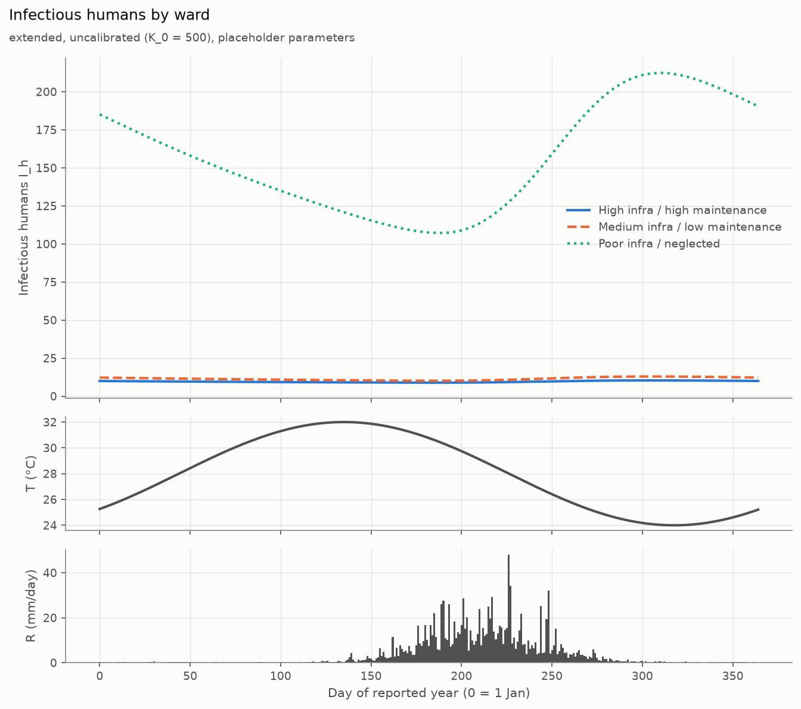

- **Shows:** infectious humans I_h through the reported year in each ward, with T(t) and R(t) below.
- **Look at:** the poor ward's I_h rises after the monsoon and peaks around day 310. The other two
  stay low and flat.
- **Do not conclude:** that the seasonal timing matches any real city. The climate is synthetic.

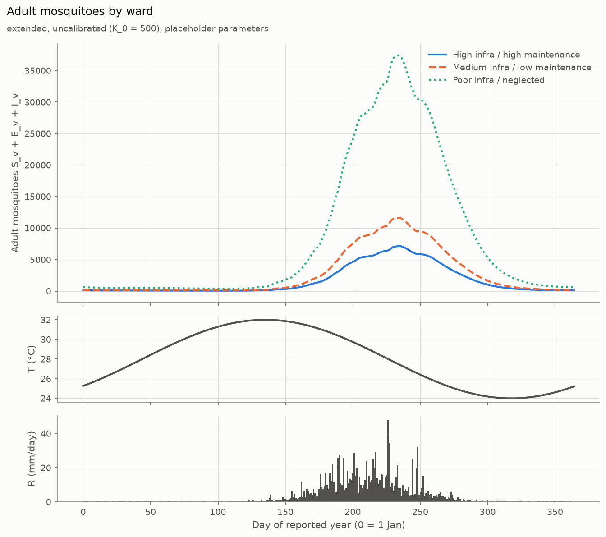

- **Shows:** adult mosquito numbers N_v.
- **Look at:** mosquitoes follow the monsoon. The poor ward's peak is about 5 times the best ward's
  (peak mosquitoes per human 3.77 vs 0.715), which is the direct effect of Ω.
- **Do not conclude:** real mosquito densities. They scale directly with the uncalibrated K_0.

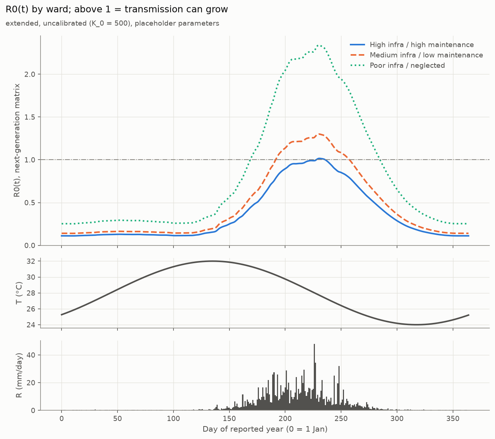

- **Shows:** R0(t) from the next-generation matrix, with a line at R0 = 1. It is defined as
  R0 = √(K_hv·K_vh), where:
  - K_hv = humans infected per infectious mosquito
  - K_vh = mosquitoes infected per infectious human
- **Look at:** R0(t) exceeds 1 only during the monsoon. Peaks are 1.02 (best), 1.3 (medium) and
  2.34 (poor). The year-round averages are all below 1: 0.364, 0.461 and 0.829.
- **Do not conclude:** that R0(t) > 1 means an outbreak. The best ward briefly exceeds 1, yet its
  local infections don't grow (see 8.4).

### 8.3 Heatmaps over drainage density × maintenance (81 cells)

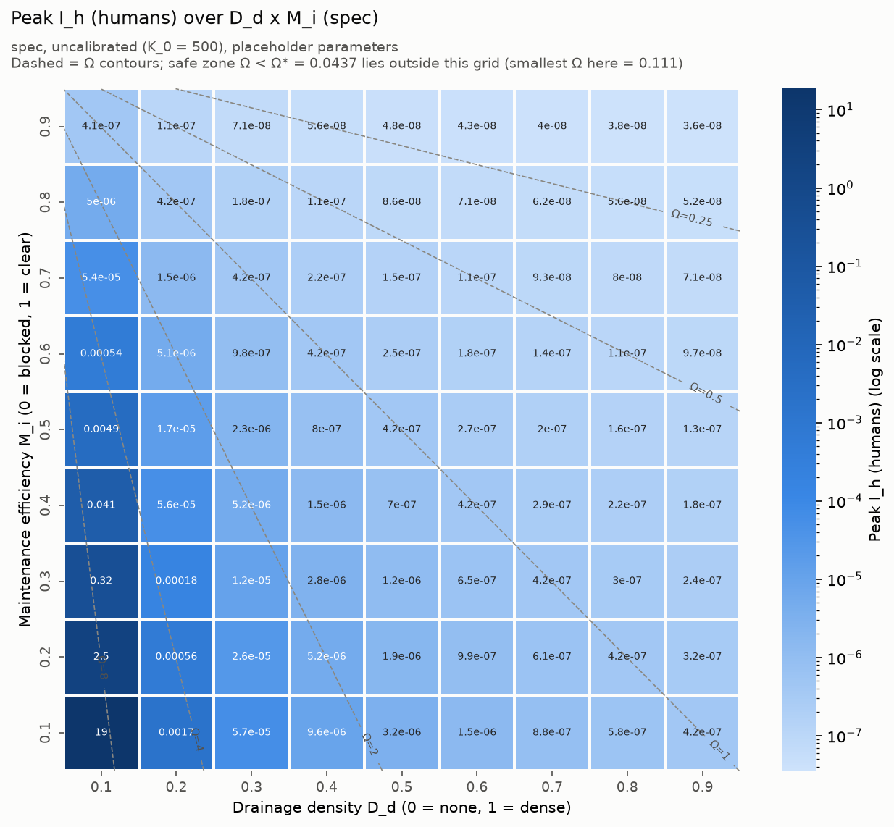
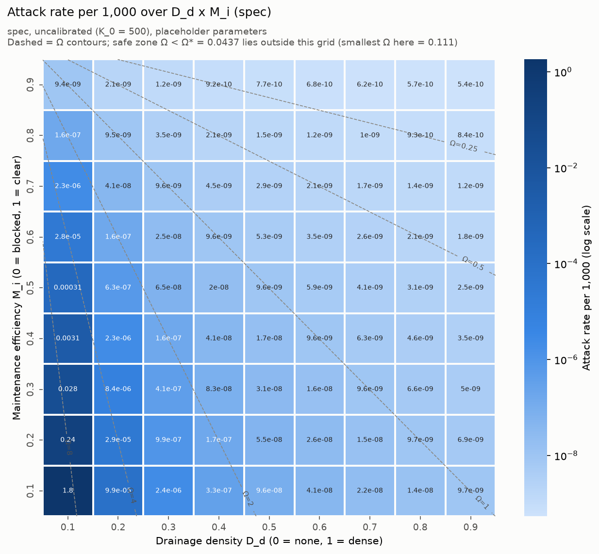
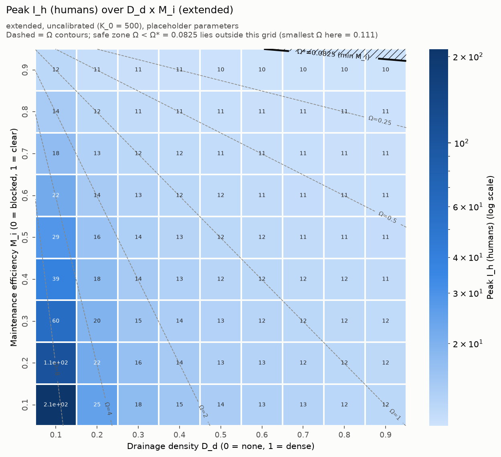
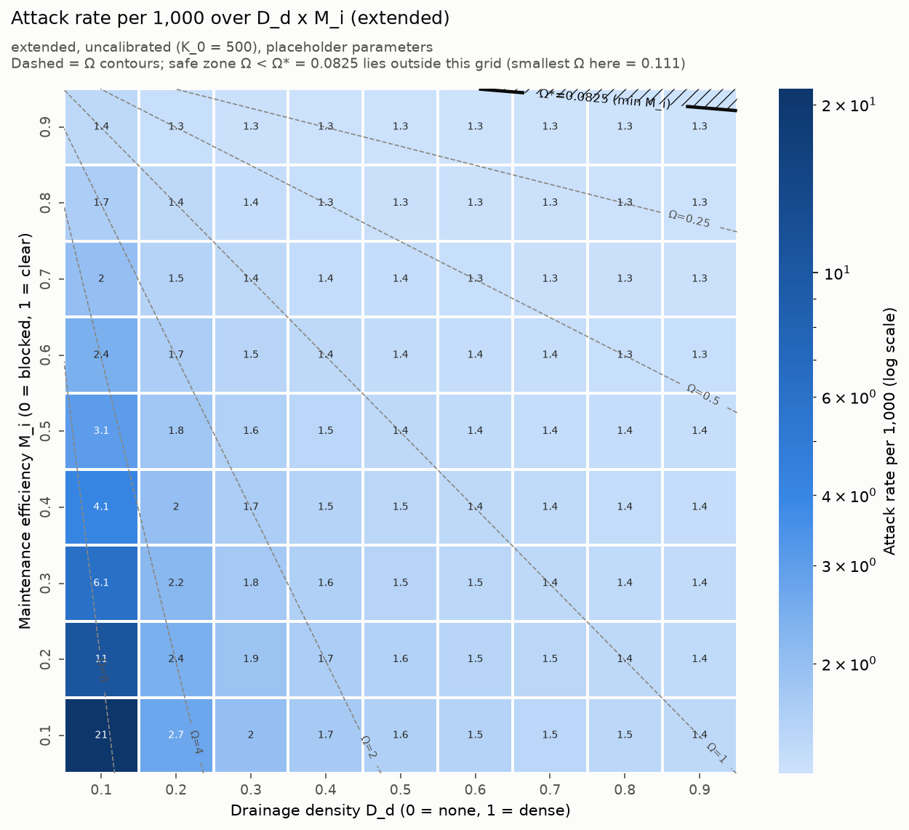

- **Shows:** each cell is one (D_d, M_i) combination, and its value is the outcome in the reported year.
  - Dashed lines are contours of equal Ω.
  - The colour scale is logarithmic because values span many orders of magnitude: in the spec
    variant, attack rate runs from 5.4×10⁻¹⁰ (smallest cell, read from the figure) up to 1.8 per 1,000.
- **Look at:**
  - The worst cell is always bottom-left (D_d = 0.1, M_i = 0.1).
  - Outcomes change along the Ω contours, not along rows or columns separately.
  - In the extended variant most cells sit near 1.3–1.5 per 1,000, close to the importation level.
- **Do not conclude:** that the cells are independent evidence. They are 81 points on one curve (see 8.5).
  - The "safe zone" (Ω < Ω*) lies **outside** this grid for both variants.

### 8.4 Two thresholds: peak R0 = 1 vs persistence

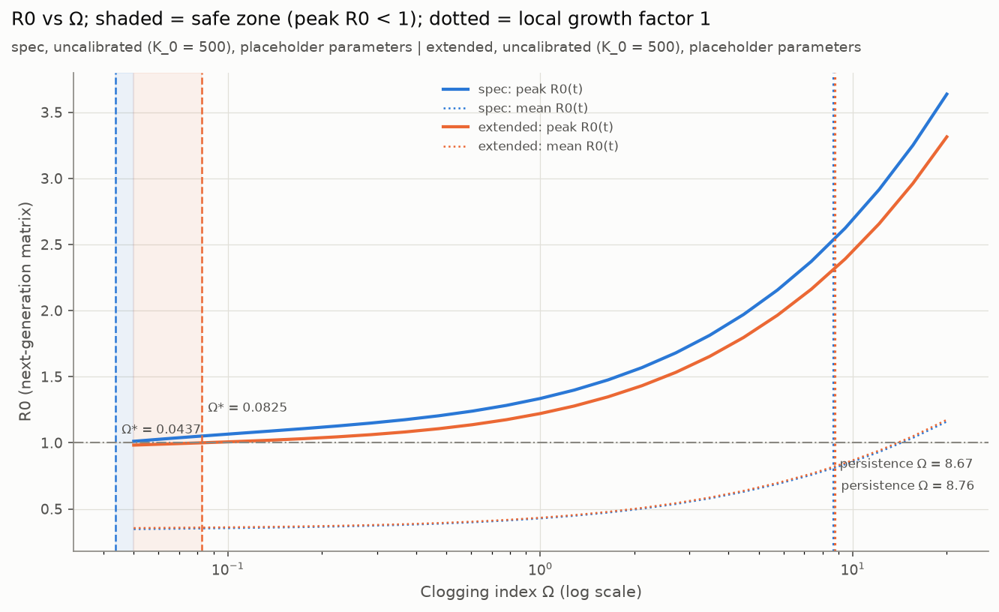

| Threshold | Meaning | Spec | Extended |
|---|---|---|---|
| **Ω\*** (peak R0(t) = 1) | below this, R0 never exceeds 1 at any time of year | **0.04367** | **0.08253** |
| **Persistence Ω** (local growth factor = 1, imports off) | below this, local infections shrink year to year | **8.673** | **8.761** |
| Ratio | | ≈ 199× | ≈ 106× |

**Minimum maintenance M_i needed at each drainage density D_d.** From Ω ≤ threshold, the condition
is M_i ≥ 1 − threshold × (D_d + ε):

| D_d | 0.1 | 0.2 | 0.3 | 0.4 | 0.5 | 0.6 | 0.7 | 0.8 | 0.9 |
|---|---|---|---|---|---|---|---|---|---|
| min M_i for peak R0 < 1 (spec) | 0.996 | 0.991 | 0.987 | 0.982 | 0.978 | 0.974 | 0.969 | 0.965 | 0.961 |
| min M_i for peak R0 < 1 (extended) | 0.992 | 0.983 | 0.975 | 0.967 | 0.959 | 0.95 | 0.942 | 0.934 | 0.926 |
| min M_i for no growth (spec) | 0.124 | 0 | 0 | 0 | 0 | 0 | 0 | 0 | 0 |
| min M_i for no growth (extended) | 0.115 | 0 | 0 | 0 | 0 | 0 | 0 | 0 | 0 |

**Why the thresholds differ so much.** R0(t) is a snapshot. Briefly exceeding 1 during the monsoon
peak lets infections grow for a few weeks. But they shrink for the rest of the year, when R0(t) is
well below 1 (yearly means 0.36–0.83). Whether infection persists depends on the balance over the
whole year. The peak criterion is therefore very cautious, and the persistence criterion much less so.

**Do not conclude:** a policy recommendation. Both thresholds depend on placeholder parameters.

### 8.5 Why results depend on D_d and M_i only through Ω

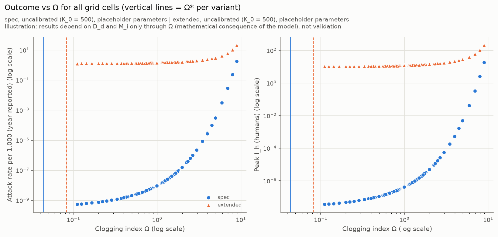

In the equations, D_d and M_i appear **only** inside Ω (in K_v and μ_A). So any two wards with the
same Ω have identical simulations. Plotting all 81 cells against Ω therefore puts them on a single
curve per variant.

This is a **mathematical consequence of the model structure, not a validation**. It means the model
cannot distinguish "build more drains" from "maintain existing drains better" except through their
combined effect on Ω. Whether that is realistic is a modelling question for you.

### 8.6 Spec vs extended

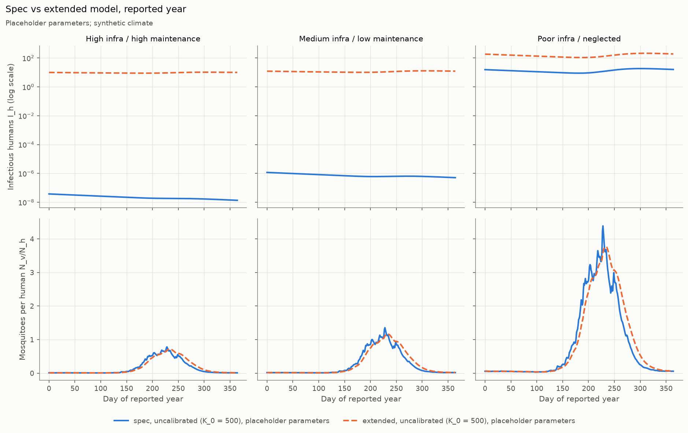

- **Shows:** for each ward, I_h(t) on a log scale (top row) and mosquitoes per human (bottom row)
  for both variants.
- **Look at:**
  - **Mosquito curves are almost identical.** Rainfall memory only smooths and slightly delays them;
    peaks are 0.715 vs 0.783 (best) and 3.77 vs 4.39 (poor).
  - **The large difference in I_h comes from importation, not from rainfall memory.** The importation
    sensitivity run (8.7) confirms this: with imports set to 0, the extended best ward falls to an
    attack rate of 5.68×10⁻¹⁰ per 1,000, the same order as spec (5.74×10⁻¹⁰).

### 8.7 Sensitivity analyses (not main results)

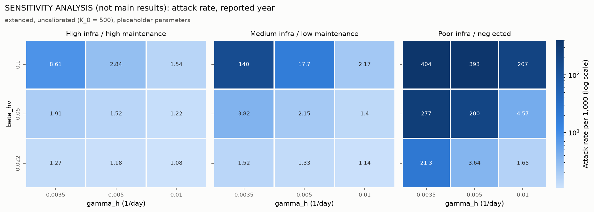

**(a) Recovery rate γ_h × vector-to-human probability β_hv** (extended variant). Each was tested at 3
values: γ_h ∈ {0.0035, 0.005, 0.01}/day and β_hv ∈ {0.022, 0.05, 0.1}.
- The ward ranking (higher Ω → higher attack rate) held in **all 9** combinations.
- Magnitudes vary enormously. The poor ward's attack rate ranges from **1.65** (γ_h = 0.01,
  β_hv = 0.022) to **404** per 1,000 (γ_h = 0.0035, β_hv = 0.1). The best ward ranges from 1.08 to 8.61.
- So the model's *direction* is robust to these two parameters, but its *size* is not.

**(b) Importation rate** (extended variant):

| Imports per 1,000/yr | Best ward: total (local) | Medium: total (local) | Poor: total (local) | Ranking holds (total / local) |
|---|---|---|---|---|
| 0 | 5.68×10⁻¹⁰ (5.65×10⁻¹⁰) | 2.69×10⁻⁸ (2.68×10⁻⁸) | 1.47 (1.47) | yes / yes |
| 0.1 | 0.128 (0.0283) | 0.154 (0.054) | 4.3 (4.21) | yes / yes |
| 1 | 1.27 (0.28) | 1.52 (0.531) | 21.3 (20.4) | yes / yes |
| 10 | 12.4 (2.65) | 14.6 (4.93) | 68.4 (59.7) | yes / yes |

- **For the better wards,** the total attack rate is roughly proportional to the import rate. Their
  outcome is mainly set by importation, a placeholder.
- **For the poor ward,** imports seed local transmission. Local cases rise from 1.47 to 59.7 per
  1,000 as imports rise from 0 to 10.

---

## 9. Limitations

1. **Synthetic climate.** T(t) and R(t) are invented shapes, not observations.
2. **Placeholder parameters.** Most of the drainage, larval and human rates are unsourced, and the
   sourced ones still need checking against the papers. β_hv = 0.022 is at the low end of literature values.
3. **Uncalibrated K_0.** Absolute mosquito numbers, EIR and case numbers are arbitrary in scale.
4. **Importation dominates the better wards** in the extended variant. Its rate (1 per 1,000/yr) is a placeholder.
5. **The poor ward is near the threshold and not converged.** Ω = 8.911 is just above the
   persistence threshold (8.673 / 8.761). It is still growing after the 20-year spin-up cap in both
   variants (growth 1.02 and 1.03 per year), so its reported values are not a steady state.
6. **The two "safe" thresholds differ by about 100–200×,** so the policy message depends on which is chosen.
7. **Deterministic model.** Numbers can shrink toward zero but never reach it. Values like
   3.76×10⁻⁸ infectious people mean "effectively extinct". A stochastic model would show real
   extinction (and chance outbreaks).
8. **Wrong species parameters for an Indian city.** The thermal functions and transmission
   parameters are based on *P. falciparum* and *Anopheles* in general. Indian urban malaria is
   often *P. vivax* (which can relapse) and *An. stephensi*, which breeds in containers and tanks as
   well as drains. Neither is represented.
9. **Ward profiles chosen by us.** The three (D_d, M_i) pairs are illustrative.
10. **Ω is the only drainage pathway.** The model can't separate infrastructure from maintenance (Section 8.5).

---

## 10. Next steps (prioritised)

1. **Calibration target and source.** Annual parasite incidence per 1,000 people for a reference
   ward. Then run `python main.py --calibrate TARGET` and check whether K_0 is well identified (the
   tool reports this).
2. **Real climate data** for the study city: daily temperature and rainfall.
3. **Importation rate** from travel or surveillance data. It strongly affects the better wards.
4. **Source β_hv, γ_h and τ** (water retention time) from literature; replace the other placeholders.
5. **Choose the threshold** to present: peak R0 < 1 or persistence.
6. **Longer spin-up** (or accept non-convergence) for wards near the threshold.
7. **Validation** against local surveillance data, e.g. ward-level case counts.
8. **Policy outputs:** minimum M_i per D_d (already computed, Section 8.4) once the parameters are credible.

---

## 11. Questions and decisions for you

1. **Calibration:** what target (annual parasite incidence per 1,000) and which source should K_0 be
   calibrated to? I calibrate to total reported incidence (imported + local).
2. **Extended changes:** are rainfall memory (#6) and importation (#8) acceptable additions to the
   spec, or should the thesis use the spec variant only?
3. **β_hv and γ_h:** which literature values should replace 0.022 and 0.0035?
4. **Treatment:** should it be modelled? Treated infections recover in weeks, not months, which
   would change results a lot (see Section 8.7).
5. **Threshold:** peak R0 < 1 or persistence (local growth < 1)?
6. **Heatmap metric:** peak I_h (the spec's definition) or attack rate per 1,000?
7. **Ω-only structure:** is it acceptable that D_d and M_i act only through Ω?
8. **Deviations #1–#9:** please review them (Section 6).
9. **Species:** should we adapt to *P. vivax* and *An. stephensi* for an Indian city?

---

## 12. Anticipated questions

**Why are the numbers so small?**
- With β_hv = 0.022, one infectious mosquito infects few people in its lifetime. At 28 °C:
  a = 0.350, μ_v = 0.1142, so a·β_hv/μ_v ≈ 0.067 people.
- K_0 is uncalibrated, and the climate is synthetic.

The model is in a low-transmission regime by construction of its placeholders. That's why only
relative comparisons are meaningful.

**Why does importation matter so much?**
In the better wards, local transmission can't sustain itself (growth < 1). Without imports, infection
fades to effectively zero. With imports, the number of cases is set mostly by how many arrive.

**Why do results depend only on Ω?**
D_d and M_i enter the equations only through Ω. It follows from the spec's structure; it isn't a
finding (Section 8.5).

**Why do the two thresholds differ by about 100×?**
Peak R0 > 1 is satisfied by a few weeks of monsoon conditions. Persistence requires growth over the
whole year, including the long dry season when R0(t) is far below 1 (Section 8.4).

**Did you tune parameters to get the expected ranking?**
No. γ_h was changed once (0.01 → 0.0035) because the original value was unsourced; that is recorded
in PROGRESS.md. β_hv was deliberately left unchanged. The ranking also holds across all sensitivity runs.

**Why didn't the spec variant converge?**
Two wards are steadily dying out (constant shrink factor 0.36 and 0.432 per year), and the poor ward
is still slowly growing. Neither reaches a steady level within 20 years.

**Is the synthetic monsoon realistic?**
It has a plausible shape: 1,357 mm/yr, 92% in June–September. But it is not data from any city.

---

## Appendix A: Glossary

| Term | Meaning |
|---|---|
| Ω (Omega) | Clogging Index, (1 − M_i)/(D_d + ε); high = blocked and sparse drains |
| D_d | drainage density, 0–1 |
| M_i | maintenance efficiency, 0 (blocked) to 1 (clear) |
| K_v | carrying capacity of breeding water for larvae |
| R_eff | rainfall with memory (extended variant), exponentially weighted with retention time τ |
| Attack rate | new human infections per 1,000 people per year |
| Local / imported | infections acquired in the ward / arriving from outside |
| EIR | entomological inoculation rate: infectious bites per person per year |
| R0(t) | reproduction number at time t from the next-generation matrix, √(K_hv·K_vh) |
| Ω* | Ω at which the yearly peak of R0(t) equals 1 |
| Persistence Ω | Ω at which local infections neither grow nor shrink year to year (imports off) |
| Growth factor | local infections this year ÷ last year |
| Spin-up | simulated years discarded before reporting, so results don't depend on the starting guess |
| Placeholder | parameter value not yet sourced from literature or data |
| Deterministic | no randomness in the dynamics; populations never reach exactly zero |

## Appendix B: Reproduction commands

```bash
cd malaria-seir
.venv/bin/python -m pytest              # 42 tests
.venv/bin/python main.py                # all results and figures (~2 minutes)
.venv/bin/python main.py --calibrate X  # calibrate K_0 to target X per 1,000/yr (not yet run)
```

The figures in `results/figures/*.png` are listed in `.gitignore`, so they are regenerated by
`main.py` rather than stored in git.

## Appendix C: File and figure index

| Item | Path |
|---|---|
| Approved spec | `docs/SPEC.md` |
| Deviation log | `docs/DEVIATIONS.md` |
| Progress log | `docs/PROGRESS.md` |
| Parameters | `src/malaria_model/params.py` |
| Infectious humans by ward | `results/figures/ward_infections.png` |
| Adult mosquitoes by ward | `results/figures/ward_vectors.png` |
| R0(t) by ward | `results/figures/ward_R0.png` |
| Heatmaps (spec / extended × peak I_h / attack rate) | `results/figures/heatmap_{spec,extended}_{peak_Ih,attack_rate}.png` |
| Outcome vs Ω scatter | `results/figures/omega_scatter.png` |
| R0 vs Ω with thresholds | `results/figures/r0_vs_omega.png` |
| Spec vs extended comparison | `results/figures/variant_comparison.png` |
| Sensitivity (γ_h × β_hv) | `results/figures/sensitivity/sensitivity_attack_rate.png` |

---

## 13. Number verification

- **Copied from the fresh `python main.py` output:** every result number in Sections 0, 8, 9, 11
  and 12. This includes the ward tables, thresholds, the minimum-M_i table, convergence counts,
  sensitivity tables, runtime (127 s) and test count (42).
- **Read from `params.py`, or printed from the code by a read-only script:**
  - parameters
  - climate statistics (T range and extremes, rainfall total, June–September share, flushing days, R_eff range)
  - Ω, habitat multipliers and flushing divisors for the wards and the grid
  - thermal values a(28) = 0.350 and μ_v(28) = 0.1142
- **Derived by simple arithmetic from those values, rounded:**
  - imported shares 78%, 65% and 4.5%
  - threshold ratios 199× and 106×
  - the flushing ratio 70×
  - the poor/best habitat ratio ≈ 5
  - a·β_hv/μ_v ≈ 0.067